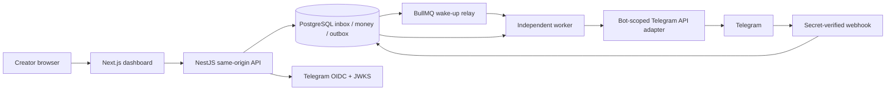
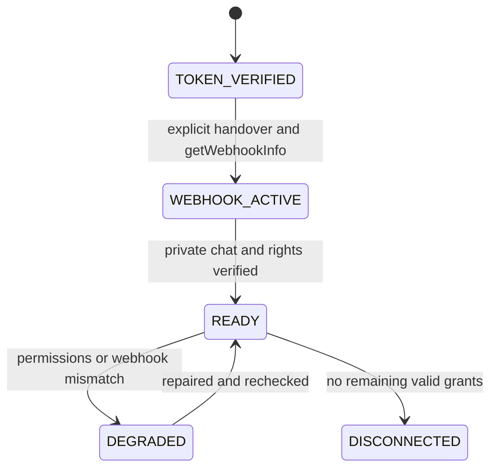
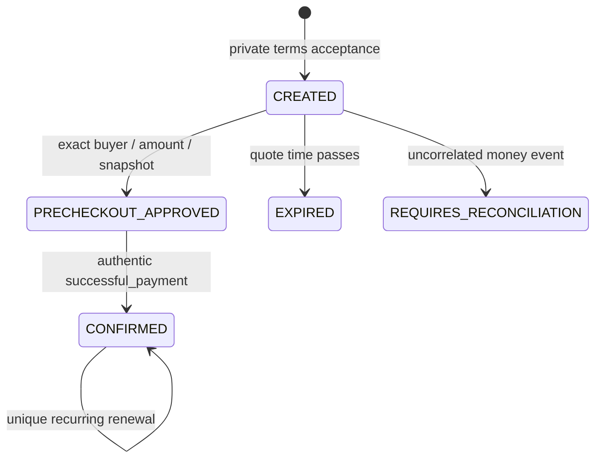
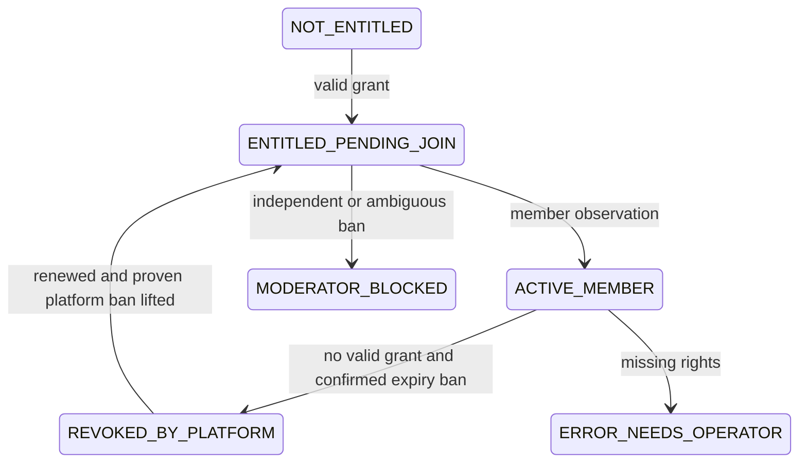

# Architecture and decisions

## Boundaries

- `packages/domain`: integer amounts, IDs, price validation, interval arithmetic and grant union.
- `packages/db`: Prisma client, tenant relations, PostgreSQL constraints, advisory transaction lock.
- `packages/telegram`: request adapter, redacted errors, invoice construction, explicit fake provider.
- `packages/app`: auth, encrypted secrets, setup, payments, access, bot commands, durable jobs and reconciliation.
- `apps/api`: REST authorization, CSRF/origin/body/rate limits, session cookies and OpenAPI.
- `apps/worker`: independent polling, BullMQ notification and scheduled sweep.
- `apps/web`: Next.js server-rendered public pages and an interactive API-backed creator dashboard. No financial authority in client components.

## ADRs

1. **Keep the requested stack**. The starting repository was empty. Exact dependency versions and pnpm lockfile are committed. TypeScript 5.9/Prisma 6 are deliberately compatible, rather than adopting major compiler/database-client upgrades mid-build.
2. **Shared application services**. Nest controllers and workers call the same financial/access functions. Root dependency installation keeps one dependency graph; workspace app manifests identify deployment entrypoints.
3. **Database-authoritative work**. Inbox, grants and outbox are committed to PostgreSQL. Redis/BullMQ wakes consumers; polling and orphan recovery remain sufficient after a Redis loss. External Telegram messages are at least once, not exactly once.
4. **Serialize per bot**. Transaction-scoped PostgreSQL advisory locks order financial, manual-grant and access mutations. Read committed queries after acquiring the lock see current grants. DB lock wait is bounded at three seconds. Network checks inside access transactions are deliberately bounded and favor safety over high throughput; a future high-volume release can partition by chat/member with a proven lock ordering.
5. **Immutable facts, mutable projections**. Payment, plan version, policy and audit have database immutability triggers. Each charge owns dated chat grants. Refund tombstones precede late charges safely. Subscription paid-through is a projection, never proof of a new debit. Confirmed refund records plus append-only audits form the refund event journal.
6. **Composite tenant FKs**. Tenant ID is checked in every service and in database references. Plan-chat arrays have a validating database trigger. Bot and Telegram chat ownership are globally unique. HTTP scope comes from a checked session membership.
7. **Separate OIDC identity from Telegram ID**. Opaque OIDC sub binds the identity record; signed profile id is a BIGINT and authorizes Telegram ownership checks. RS256 is the configured default; changing provider algorithms requires an intentional tested change.
8. **Credential encryption**. AES-256-GCM authenticates ciphertext with tenant and key version. A supplied key is required locally. Production KMS wrapping/rotation across multiple key versions is a release blocker, not a claimed deployed capability.
9. **Accessible direct CSS**. Small semantic controls and native modal dialogs use authored CSS instead of adding an unneeded component framework. There are no hidden client-side billing rules. This is a documented deviation from the prompt's suggested Tailwind primitives.
10. **Safety under ambiguous provider outcomes**. A timed-out refund is not reissued blindly. A ban lacking confirmed platform provenance is never automatically lifted. Operators repair/reconcile and then replay. No global historic member enumeration is assumed.

## State transitions

`EXPIRED` and `REQUIRES_RECONCILIATION` are domain states; currently quote expiry is derived from expiresAt and invalid events are represented by the quarantined inbox/incident. No pre-checkout creates a charge. Initial approved late charges remain valid; established recurring renewals do not reuse quote expiry.

## Recovery and limitations

Jobs have leases, ownership tokens, heartbeats, bounded exponential retries with jitter, Telegram retry_after handling and a dead-letter state. Inbox acknowledgements follow durable writes. A sweeper repairs orphaned inbox intent and reprojects member access; it cannot discover all historic Telegram members.

A crash between an external effect and recording its result can create duplicate messages/invites. Convergent access checks avoid blind grants/revocations. A crash after an unrecorded ban may require operator review; safety takes precedence over automatic unban. Telegram cannot report who last re-applied an identical ban; out-of-order moderation updates must be tested live and ambiguous cases reviewed.

Dashboard member queries paginate; history is bounded to the latest 100 records and labeled as such. Metrics aggregate the entire selected period. The initial state endpoint still loads all tenant grants/memberships/plan versions and exports buffer JSON: cursor projections/streaming are a scale hardening item, not a claim of large-tenant performance.
